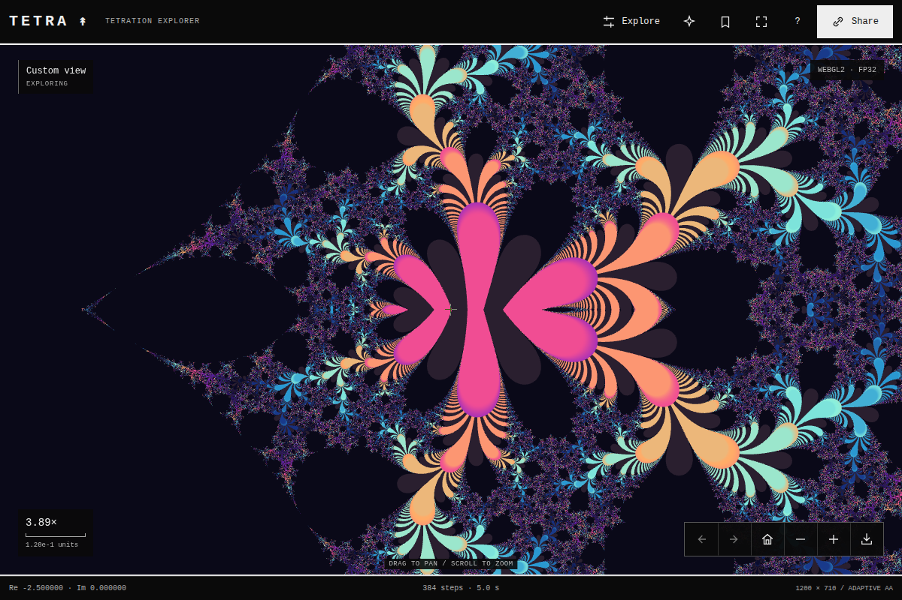
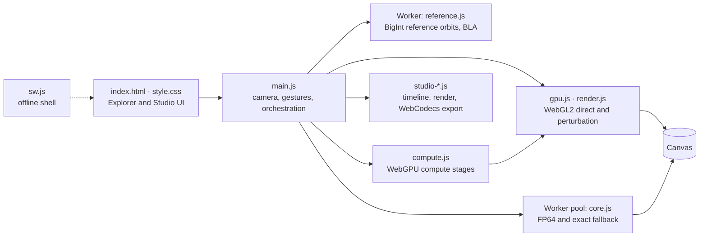

# TETRA

**Browser-native tetration fractal explorer and motion studio.** Zoom from the whole complex plane down to span `1e-200` at full display resolution, discover new structure, share exact views and export videos, all on the device with no install, account or server-side computation.

[](https://github.com/MongLong0214/Tetration/actions/workflows/ci.yml)
[](https://github.com/MongLong0214/Tetration/releases/latest)

**Live:** [tetration.vercel.app](https://tetration.vercel.app) · **Version:** 1.3.0 · [Changelog](CHANGELOG.md) · [Releases](https://github.com/MongLong0214/Tetration/releases)



<details>
<summary><strong>Contents</strong></summary>

- [Highlights](#highlights)
- [Quick start](#quick-start)
- [Explorer](#explorer)
- [Motion Studio](#motion-studio)
- [Platform support](#platform-support)
- [Architecture](#architecture)
- [Computation](#computation)
- [Performance](#performance)
- [Security and privacy](#security-and-privacy)
- [Quality and testing](#quality-and-testing)
- [Deployment](#deployment)
- [Releases and branching](#releases-and-branching)
- [Repository layout](#repository-layout)
- [Documentation](#documentation)
- [Support and contributing](#support-and-contributing)
- [License](#license)

</details>

## Highlights

| | |
| --- | --- |
| **Deep zoom** | Spans from `1e12` down to `1e-200`. Perturbation with bilinear approximation keeps full display resolution at every depth. |
| **GPU first, always available** | WebGPU compute and WebGL2 on the GPU, with automatic fallback to a pool of FP64 Workers and recovery after GPU loss. |
| **Responsive navigation** | Live frames sized to the measured GPU speed, inertia, glide and progressive refinement up to 16 samples per pixel. |
| **Exact sharing** | The URL fragment carries the camera at 256 decimal places. The link reproduces the view, and saved views stay on the device. |
| **Motion Studio** | Start/End camera paths, looks and rhythm effects, and MP4/AVC or WebM/VP9 export up to 1080p and 120 seconds, encoded in the browser. |
| **Private by construction** | No backend, analytics, login or runtime dependencies. A strict CSP with `connect-src 'none'`. It installs as an app and works offline. |

## Quick start

**Use it:** open [tetration.vercel.app](https://tetration.vercel.app) in a current Chromium-based browser or Safari with WebGL2.

**Run it locally:** Node.js 22 or 24 (`.nvmrc` selects 24). There is nothing to install.

```bash
git clone https://github.com/MongLong0214/Tetration.git && cd Tetration
npm test           # unit tests
npm run dev        # builds, then serves http://localhost:4173
npm run build      # dist/: index.html, sw.js, manifest.webmanifest, icons
npm start          # serve an existing build
```

The development server binds to loopback; set `HOST=0.0.0.0` only for intentional LAN testing. There is no file watcher, so rebuild after editing. Service workers and clipboard sharing need HTTPS or localhost.

## Explorer

The app opens between the basins (centre −1.9, width 3), where the large petals fill the screen and the surrounding structure stays in view. **Home** returns to the overview of the complex plane (centre −0.5, width 8). Drag, scroll or pinch anywhere: the image follows immediately and keeps refining while you move. When you pause, it resolves within the selected engine's pixel budget and smooths edges with up to 16 orbit samples per pixel.

| Action | Input |
| --- | --- |
| Pan | Drag (with inertia) / arrow keys; Shift + arrow for larger steps |
| Zoom | Scroll / pinch / + and − |
| Zoom into a point | Double-click |
| Inspect a small structure | Detail / Shift-drag / Z then drag; Escape cancels |
| Discover a new detailed place | D or the ✦ button |
| Overview / starting points | Home / 1–7 |
| Previous / next view | Alt + Left / Right |
| Focus / controls | F / C |
| Saved views / share / save image | B / S / E |
| Grid / guide | G / ? |

- **Starting points:** seven, from the overview through **Bloom** (internal petals, span 0.00025) to **Plume** (10¹¹), **Abyss** (10²⁵) and **Horizon** (10¹⁰⁰).
- **Palettes:** **Aurora**, **Ember**, **Tidal** and **Mono**. Escape bands keep cycling through the palette at depth. Optional **Color flow** rotates hues without recomputing. It starts off, pauses in a hidden tab and stops when reduced motion is requested.
- **Share** copies the exact view link, or opens the native share sheet on touch devices. **Save image** downloads a PNG at the rendered resolution. Up to 24 named views can be saved on the device.
- **Installable and offline:** TETRA installs as an app and reopens offline.

## Motion Studio

Open **Studio** from the toolbar. Frame a view and capture it as **Start**, then zoom or drag and capture **End**; a still camera is also a valid shot. Adjust the **Motion / Look / Rhythm** tabs and press **Play**. **Export video** holds the output settings. **Save project** keeps editable settings on the device, and Projects exchanges JSON. The built-in **How to make a video** guide covers the full workflow.

| Output | Options |
| --- | --- |
| Container / codec | MP4/AVC, or WebM/VP9 where the encoder is confirmed |
| Resolution / aspect | 720 or 1080; 16:9, 9:16, 1:1 |
| Frame rate / length | 24 or 30 fps; 2–120 seconds, with an optional hold on the End camera |
| Quality | AA4 or AA16 samples; 12 / 24 / 40 Mbps tiers at 1080; Raw or Stable motion |
| Guidance | Total zoom, peak per-frame zoom and a recommended length in the Motion tab |
| Large files | Exports estimated above 64 MiB stream to a file you choose, where the browser supports it |

Export computes every sample offline and encodes in the browser through WebCodecs. It needs WebGL2 and a supported encoder; non-neutral effects also need half-float render targets. A hidden export pauses at the next frame boundary and resumes when the tab is visible again. Files never leave the device. See [Motion Studio](docs/MOTION_STUDIO.md) for editing, output and practical limits.

## Platform support

| Capability | Requirement | Fallback |
| --- | --- | --- |
| GPU exploration | WebGL2 (GLSL ES 3.0) | FP64 Worker pool and Canvas2D |
| Faster final stages and live frames | WebGPU compute | WebGL2 programs |
| Video export | WebGL2 + WebCodecs encoder (AVC or VP9) | Export is unavailable; exploration still works |
| Install and offline | Service worker over HTTPS or localhost | Online use |
| Large-file export | File System Access (`showSaveFilePicker`) | In-memory output up to 64 MiB |

**Qualified:** Chromium on Apple Silicon with ANGLE Metal (hardware GPU), plus Chromium and WebKit in GitHub Actions on Ubuntu and macOS runners. **Not yet qualified:** physical iPhone or Safari devices, Firefox, Windows and Android GPUs, and long thermal soaks. Software graphics, emulated touch and Linux WebKit do not stand in for those devices. Details are in the [production review](docs/PRODUCTION_REVIEW.md).

## Architecture



- **One static bundle.** `build.cjs` inlines the scripts and stylesheet into `index.html`, hashes them into the CSP and writes `dist/`. Vanilla JavaScript, no framework and no runtime dependencies.
- **WebGL2** renders GPU views in bounded tiles whose batches adapt to measured speed (about 14 ms). Every orbit program is linked twice so first visits on ANGLE Metal get the same binary and image as cached visits.
- **WebGPU compute**, where available, computes the final 1×, 4× and 16× stages and the live frames through a persistent work queue. Any WebGPU error hands the stage back to WebGL.
- **Workers** compute the reference orbits and, without a usable GPU, render FP64 tiles from a persistent pool of 1–8 Workers. A restored GPU context is used again automatically.
- **Motion** renders single-sample live frames within about 12 ms. After a pause the view refines adaptively, and a pan computes only the newly exposed strips.

## Computation

For each complex base `z`:

```text
w₀ = 1
wₙ₊₁ = exp(wₙ · Log(z))
Arg(z) ∈ (−π, π]; the negative real axis uses +π
```

Zero is excluded. This is finite, integer-height iteration, not an analytic extension to arbitrary heights.

| Observation | Interpretation |
| --- | --- |
| Fixed-point candidate | Consecutive values repeatedly approach within a tolerance |
| Period-2 candidate | Values repeatedly approach the value two steps earlier |
| Unresolved | No other stopping condition within the iteration limit |
| Threshold crossed | Re(w · Log z) exceeded ln 10¹⁰, i.e. the next \|w\| would pass 10¹⁰ |
| Numerical limit | Undefined input, underflow, or a phase too large to resolve |

**No shade proves convergence, periodicity or divergence.** Engines differ in numerical tolerance, so boundaries and chaotic regions can change between engines. Dark unresolved regions are not empty space.

### Deep zoom by perturbation

Below a pixel spacing of 2⁻¹⁶ of the coordinate scale, TETRA switches to perturbation:

1. One **reference orbit** `V[k]` is computed in a Worker with binary fixed-point BigInt arithmetic at the view's precision (depth + 40 digits, up to 256).
2. Every pixel iterates only its offset `d = w − V` on the GPU: `ε = V·δL + d·L`, `w' = V'·exp(ε)`, `d' = V'·expm1(ε)`, with `δL = log1p((z − z₀)/z₀)`.
3. Offsets are stored as an FP32 mantissa with an integer exponent, so spans far below the FP32 range keep full relative precision. Small arguments use series instead of GPU built-ins.
4. Threshold crossing compares against the exact difference `ln 10¹⁰ − Re(L₀V[k])`, so boundaries near the reference stay exact.
5. A pixel rebases to the virtual start `V[0] = 0` when `|w| < |d|` or when the reference ends. Lower-half pixels use the conjugate orbit of their mirror image, so one reference handles the branch cut.
6. **Bilinear approximation (BLA).** While the offset is tiny, runs of 2ʲ steps are linear: `d ← A·d + B·δL`. Each run stores the largest `|d|` that keeps every covered step linear, and runs never cover a step where the reference nears the threshold, a numerical limit, a fixed point or a period-2 cycle. At 10¹⁰⁰ about 90% of a typical orbit's steps are skipped.

The reference is reused while panning and zooming (within 64 spans and 16 decades of extra depth). With **Auto** iterations the limit grows as `320 + 34 × decades` (quantised to 256 … 16,384), because escape times grow by about 30 steps per decade of zoom. Fix the iteration limit when comparing magnifications.

| Limit | Value |
| --- | --- |
| Camera coordinates | 256 decimal places, fixed point |
| Reference precision | 30–256 decimal places |
| Horizontal span | 1e−200 to 1e12 |
| Each coordinate component | −1e12 to 1e12 |
| Iteration limit | Auto, or 64 … 16,384 |
| Display resolution | GPU: up to 3× density, 8.3 MP and 8,192 px per side; FP64: 1.6 MP / 2,048 across; Exact: 72 across |

FP32 perturbation (with or without BLA) reproduces FP64 perturbation pixel for pixel in structured regions and keeps the same structure and class statistics in chaotic regions. **CPU · FP64** renders the same deep views with FP64 offsets; **Exact · slow** evaluates each pixel with decimal BigInt orbits as a check.

## Performance

Measured on Chrome 155 / ANGLE Metal / Apple M2 Pro (one machine, v1.2.0 review). These numbers describe that machine, not every device.

| Scenario | Result |
| --- | --- |
| Real-pointer exploration, shallow to span 1e-200 (7 cases × 12 s) | rAF p95 16.7–16.8 ms; input-to-next-frame p95 14.4–15.3 ms |
| Sustained deep interaction, 16,384 iterations, AA16 | rAF p95 16.7 ms; final 2880×1624 AA16 refinement 13.4–14.4 s |
| Shallow AA16 1080p frames, WebGPU vs WebGL | 2.99 s vs 28.63 s for four frames, identical pixel hashes |
| Export cancellation (deep output, five runs) | 68–117 ms |

Highest-quality deep exports remain computationally expensive. Measurements, rejected experiments and remaining costs are in [Performance research](docs/PERFORMANCE_RESEARCH.md) and the [performance handoff](docs/HANDOFF_PERFORMANCE.md).

## Security and privacy

- **No data leaves the device.** No backend, external computation API, analytics, telemetry or login. Saved views and projects are written to local storage only after an explicit action.
- **Strict Content Security Policy.** The build hashes the exact script and stylesheet bytes: no `unsafe-inline` or `unsafe-eval`, `connect-src 'none'`, Workers from `blob:` and the same-origin service worker only. Do not modify the built inline code without rebuilding.
- **Hardened headers** (`vercel.json`): `frame-ancestors 'none'` and `X-Frame-Options: DENY`, `nosniff`, `Referrer-Policy: no-referrer`, a restrictive `Permissions-Policy`, HSTS, and same-origin COOP/CORP.
- **Supply chain.** No npm runtime dependencies. The vendored MP4/WebM muxer ships in `src/vendor/`, and the service worker caches only the app's own files (network first).
- **Release integrity.** Every GitHub Release carries `SHA256SUMS` for its application archive.

To report a vulnerability, open an issue that asks for a private contact and leave the details out of it.

## Quality and testing

Every pull request, and every push to `main`, `dev`, `release/**` or `hotfix/**`, runs unit tests, lint, a build and 18 browser suites in separate GitHub Actions jobs. GPU-sensitive suites run on macOS runners, and evidence reports are kept for 14 days.

```bash
npm test
npm run lint                     # ESLint 10.1.0 through npx
npm run build
python3 -m pip install -r tests/requirements.txt
npm install --no-save --package-lock=false --ignore-scripts axe-core@4.11.0
python3 -m playwright install --with-deps chromium webkit
npm start &                      # serves dist on http://127.0.0.1:4173
export TETRA_BASE_URL=http://127.0.0.1:4173
npm run test:e2e                 # all explorer browser suites
npm run test:studio              # Motion Studio unit and browser suites
npm run test:webkit
```

| Suite | Scope |
| --- | --- |
| `npm test` | Reference orbits vs decimal BigInt, FP64 perturbation vs exact orbits, BLA tables, Workers, discovery, CSP/build/server/offline shell, saved views, Studio model and export |
| `test:browser` | Core flows, CSP enforcement, exact links, limits, mobile focus and touch |
| `test:release` | Served headers and bytes, reference pixels, engine switching, GPU loss/restore, degraded features, offline reload |
| `test:deep` | GPU perturbation (plain and BLA) vs FP64 and exact orbits, BLA speed, full resolution at every depth, WebGPU vs WebGL and FP64 |
| `test:quality` | Antialiasing error vs 64-sample references, live-frame accumulation, grid lock, glide, inertia, reduced motion, colour flow |
| `test:explorer` | Saved views, history, shortcuts, discovery, sharing, fallbacks, viewports, axe-core accessibility |
| `test:perf` | First frame, live-frame cadence, main-thread long tasks, reference speed, resource leaks |
| `test:reuse` | Native-resolution pan overlap, AA16 exposed strips, cache return and Detail |
| `test:interactions` | Region selection, cancellation, density/layout and input transitions |
| `test:production` | Export pixels, history, storage, recovery, native input after cold maximum requests |
| `test:zoom` | Repeated native Auto emergence and fixed-cap point stability through 62 zooms |
| `test:maximum` | Cold deep maximum requests, native navigation, FP32 phase/AA bit comparisons and cancellation |
| `test:studio` | Studio capture, effects, UI, failures, deep output, motion, shared view and export performance |
| `test:webkit` | WebKit flows; affected suites also run with `TETRA_BROWSER=webkit` |

`CHROMIUM_PATH` selects a Chromium executable and `AXE_CORE_PATH` an axe-core script. `TETRA_HARDWARE_BROWSER=1` selects full Chromium with native GPU support on macOS. Run local GPU suites one at a time. See [validation evidence](docs/VALIDATION.md).

## Deployment

Production runs on Vercel and redeploys on every push to `main`; other branches get preview deployments.

| Setting | Value |
| --- | --- |
| Framework | Other |
| Build command | `npm run build` |
| Output directory | `dist` |
| Install command | `echo No dependencies` |
| Environment variables | None |

Other static hosts work if they send headers equivalent to `vercel.json` and serve `sw.js` as JavaScript. URL fragments carry the view, so no route rewrite is needed. See [publication and deployment](docs/PUBLISHING.md).

## Releases and branching

TETRA follows [Semantic Versioning](https://semver.org) and records every change in the [changelog](CHANGELOG.md). Pushing a `v<version>` tag on `main` runs the Release workflow. It checks the tag against `package.json` and `main` ancestry, runs tests, lint and a build, and publishes a GitHub Release with `tetra-v<version>.zip` and `SHA256SUMS`. Branch roles (`main`, `dev`, `feature/*`, `release/*`, `hotfix/*`) are described in [PUBLISHING.md](docs/PUBLISHING.md).

## Repository layout

| Path | Purpose |
| --- | --- |
| `src/main.js` | Camera, gestures and motion, render orchestration, references, export, UI |
| `src/reference.js` | Binary fixed-point reference orbits for perturbation |
| `src/core.js`, `src/precision.js` | Orbit classification (FP64, perturbation, exact), palettes, discovery, decimal arithmetic |
| `src/gpu.js`, `src/render.js` | WebGL2 direct and perturbation shaders, frames and tiles; resolution and scene utilities |
| `src/compute.js` | WebGPU compute kernels for final stages and live frames |
| `src/studio*.js` | Motion Studio model, camera, rendering, encoder and export |
| `src/worker.js`, `src/saved.js` | Reference/tile/discovery Worker and validated local saved views |
| `src/sw.js`, `src/manifest.webmanifest`, `src/assets/` | Offline shell and app icons |
| `src/index.html`, `src/style.css` | Interface around the map |
| `build.cjs`, `serve.cjs` | Single-file build with CSP hashes; static server |
| `tests/` | Numerical references, unit tests and browser suites |
| `tools/perf/` | Performance measurement probes |

## Documentation

| Document | Contents |
| --- | --- |
| [Motion Studio](docs/MOTION_STUDIO.md) | Studio editing, output settings and limits |
| [Production review](docs/PRODUCTION_REVIEW.md) | Review findings, measured behaviour and readiness limits |
| [Validation](docs/VALIDATION.md) | Test evidence per release |
| [Performance research](docs/PERFORMANCE_RESEARCH.md) | GPU timers, experiments and remaining costs |
| [Performance handoff](docs/HANDOFF_PERFORMANCE.md) | Architecture, baselines, bottlenecks and next steps |
| [Publishing](docs/PUBLISHING.md) | Branching, release and deployment process |
| [Changelog](CHANGELOG.md) | Changes per version |

## Support and contributing

[Open an issue](https://github.com/MongLong0214/Tetration/issues) with a shared view URL, device and browser, iteration limit and engine. Numerical changes should include a reproducible case and independent reference values. Work on a `feature/*` branch (branch roles are in [PUBLISHING.md](docs/PUBLISHING.md)); pull requests must pass `npm test`, `npm run lint` and CI.

## License

No license has been granted yet, so all rights are reserved by the repository owner, who will choose the license. `private: true` in `package.json` prevents npm publication; it does not make this repository private.
